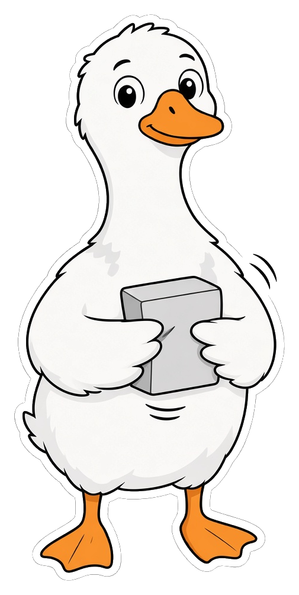

<p align="center">
  
</p>

<h1 align="center">goose-deflate</h1>

<p align="center">
  🗜️ DEFLATE, zlib, and gzip for <a href="https://github.com/aardappel/goose">Goose</a><br>
  <strong>0.2</strong> · <a href="LICENSE">Apache-2.0</a>
</p>

DEFLATE as specified by [RFC 1951](https://www.rfc-editor.org/rfc/rfc1951), with the [zlib](https://www.rfc-editor.org/rfc/rfc1950) and [gzip](https://www.rfc-editor.org/rfc/rfc1952) wrappers.

`inflate::decode` reads stored, fixed Huffman, and dynamic Huffman blocks. `raw::encode` writes one fixed Huffman block, or stored blocks of at most 65535 bytes. The encoder output is not a miniz compression level. `PORTING.md` says what was left out.

## Example

```goose
import deflate from "../deflate";
import deflate.raw;
import deflate.inflate;

fn main() {
    let packed = raw::encode("goose");
    let back, ok = inflate::decode(packed);
    print(ok);
    print(back);
}
```

`deflate.goose` is the package entry. Importing the package does not load an algorithm. `import deflate.inflate` loads `inflate.goose` from the package root.

## Check

Install the Goose compiler, then from this directory:

```sh
goose tests/self_check.goose
```

A good run prints `deflate ok`.

## Modules

| Module | What it does |
| --- | --- |
| `checksum` | CRC-32, starting at 0, and Adler-32, starting at 1 |
| `inflate` | Raw DEFLATE decoder. Returns the bytes and false on a truncated or illegal stream |
| `raw` | Raw DEFLATE encoder |
| `zlib` | CMF, FLG, the raw stream, and an Adler-32 trailer |
| `gzip` | A 10-byte header, the raw stream, CRC-32, and ISIZE |

## Good to know

`zlib::decompress` and `gzip::decompress` return false when the wrapper or the stream is rejected. Checksums are not constant-time. An empty raw block is `03 00`.

## License

Apache-2.0. Free and open to everyone. The terms are in [LICENSE](LICENSE).
